# Task 1 — Báo cáo GUI

Task 1: thiết kế và thực thi GUI cho Home (H) / Product Detail (D). 52 ID, 122 instance; 119 instance có quan sát UI thuộc 51 ID. Có quan sát UI không đồng nghĩa mọi assertion đã được thực thi hoặc đạt. Ba instance không có UI: GUI-015 H/D (zoom trình duyệt 200%) và GUI-017 real-IME. Chưa kiểm tra zoom thật và IME thật; nhập Unicode không thay thế IME. GUI-033 H/D đạt theo kiểm tra thủ công do người dùng báo cáo, không phải lượt chạy mới của agent. GUI-036 D còn needs-review về applicability, không tự gán N/A. Yêu cầu ≥3 nền tảng thuộc Task 3, không thuộc báo cáo này.

## Kết quả

| Phân loại | Raw | Effective |
|---|---:|---:|
| pass | 44 | 75 |
| fail | 26 | 31 |
| blocked | 14 | 15 |
| needs-review | 38 | 1 |

Raw là kết quả runner ban đầu; effective là kết quả sau đối chiếu evidence và review có phạm vi, không phải một lần chạy lại. Native runner passed không đồng nghĩa GUI passed. Không có phê duyệt tổng thể toàn bộ assertion.

## Thiết kế và nguồn

Checklist gốc giữ nguyên [GUI_Checklist.md](../GUI_Checklist.md). R là yêu cầu SRS; H là heuristic; L là tài liệu giảng dạy, không phải yêu cầu sản phẩm độc lập. Mục hỗn hợp giữ nguyên R/H; không tự chuyển heuristic thành lỗi trái spec. GUI-049/050 do AI đề xuất và sinh viên giữ lại; GUI-051/052 do sinh viên đề xuất, AI chuẩn hóa.

## Môi trường và truy vết

Windows Chromium; VD 1440×900, VM 390×844 CSS px. Hai viewport không phải hai nền tảng. Run 2026-11-08T07-51-06-876Z. Mỗi instance trong results.json chứa Actual, assertion gốc, phân loại raw/effective và đường dẫn evidence tương đối trong run lưu trữ. Những đường dẫn nguồn này là định danh lưu trữ, không phải hyperlink hoặc tệp đi kèm gói di động. Không sửa expected theo kết quả thực tế.

## Đọc chi tiết

- [Bảng 122 instance và Actual](index.html)
- [Excel: Design, Execution, Summary](GUI_Checklist_Results.xlsx)
- [Kết quả máy đọc](results.json)
- [Findings và evidence tuyển chọn](findings/README.md)

Workbook Design có 52 mục giữ nguyên Expected/Căn cứ; Execution có 122 dòng với Actual, ghi chú, raw/effective và mapping evidence. Screenshot tuyển chọn đi kèm findings; trace/video và native report đầy đủ nằm trong run lưu trữ, không phải tài nguyên portable.

## Giới hạn

Blocked không được tính pass. GUI-026/027 có UI quan sát một phần nhưng chưa đủ kết luận validation do control/feedback che khuất. GUI-050 không xác nhận được state prerequisite. Những lỗi heuristic được phân biệt với yêu cầu SRS trong findings. Báo cáo này không xác nhận mọi trạng thái ngôn ngữ, mọi vùng không xuất hiện trong evidence, zoom/IME hoặc nền tảng chưa chạy.

## Báo cáo toàn bộ lỗi và vấn đề thiết kế đã phát hiện

Theo §6 Task 1, mọi bug phải được ghi trong báo cáo Markdown và GitHub Issues có screenshot. Phần dưới ghi trực tiếp toàn bộ **19 nhóm triệu chứng** từ **31 biến thể Fail**; không chỉ dẫn sang danh mục. Có **12 nhóm R** (sai khác yêu cầu) và **7 nhóm H** (heuristic/design); chưa chứng minh root cause hoặc số lỗi mã nguồn độc lập. Các file findings riêng giữ observation/actions chi tiết. **Đã đăng 19 GitHub Issues**, mỗi Issue có screenshots nhúng từ commit evidence 85b35d4884268a438a6e9360721cb94f6c7d1cef; URL được ghi trong từng nhóm dưới đây. Repo đã public; Issues và ảnh được kiểm tra truy cập không đăng nhập.

### Điều kiện chung và phương pháp

- Windows 10.0.26300 x64; Playwright Chromium 158.0.8127.18 headless, vi-VN, DPR 1, zoom 100%. VD = 1440×900; VM = 390×844 CSS px, không phải thiết bị di động thật.
- SUT revision được ghi trong lượt chạy: d6ad1c3f573412dd5bf44a42bb6997df6bd4e0c1; Home /, Detail /product/1; run 2026-11-08T07-51-06-876Z.
- Recipe dưới đây tái dựng từ saved evidence, không phải lần tái hiện mới. Fault injection/delay/response ordering chỉ áp dụng những case ghi rõ. Database mở READONLY và bỏ initializer: quan sát add-to-cart chỉ kết luận về feedback UI, không chứng minh write/persistence.
- Expected giữ nguyên theo từng instance. Một instance có thể có cả assertion đạt và không đạt; actual tóm tắt chỉ mô tả triệu chứng gây Fail. DOM/accessibility/network evidence trong findings hỗ trợ các lỗi không thể chứng minh chỉ bằng ảnh.
- Severity là đánh giá tác động, không phải mức do SRS ấn định. Ảnh bên dưới chỉ lấy từ failed instances; các ảnh trùng nội dung được dùng chung có truy vết.

### Danh mục đối chiếu

| Nhóm | Phân loại | Checklist | Biến thể Fail |
|---|---|---|---:|
| R01 — Home prices use VND instead of ₫ | R | GUI-004 | 1 |
| R02 — Product detail omits category | R | GUI-005 | 1 |
| R03 — Home product images have empty alternative text | R | GUI-006, GUI-047 | 2 |
| R04 — Home has two level-one headings | R | GUI-008 | 1 |
| R05 — Detail positive action uses green instead of blue | R | GUI-010 | 1 |
| H01 — Narrow Home heading collapses into a word column | H | GUI-012 | 1 |
| H02 — Search field has only a placeholder | H | GUI-016 | 1 |
| R06 — Search keyword is rendered as HTML | R | GUI-022 | 1 |
| H03 — Quantity spinbutton lacks an accessible name | H | GUI-023 | 1 |
| R07 — Detail breadcrumb is missing | R | GUI-030 | 1 |
| R08 — Add action produces no visible feedback on Home and Detail | R | GUI-031, GUI-048 | 8 |
| R09 — Home has no route-dependent selected navigation state | R | GUI-036 | 1 |
| R10 — Home list and search omit loading indication | R | GUI-037, GUI-038 | 2 |
| R11 — No-result search lacks message and illustration | R | GUI-040 | 1 |
| H04 — Home request failures have no error feedback | H | GUI-041, GUI-052 | 3 |
| H05 — Detail request failure remains loading | H | GUI-043 | 1 |
| H06 — Older search response overwrites newer results | H | GUI-045 | 1 |
| H07 — Search label follows unsubmitted draft text | H | GUI-046 | 1 |
| R12 — Required quantity label lacks asterisk | R | GUI-049 | 2 |

### R01 — Home prices use VND instead of ₫

**Phân loại:** R — sai khác yêu cầu. **Severity:** Medium.

**Điều kiện và cách tái hiện:** Mở Home / ở VD 1440×900, đợi đủ 5 thẻ sản phẩm; đọc đơn vị tiền tệ trên cả 5 giá và đối chiếu ký hiệu ₫.

**Actual (triệu chứng):** Home displays VND on all five prices.

**Instance:** GUI-004--default--H--windows-chromium--VD

**Expected nguyên văn (R):**

> Dùng ₫ và phân cách hàng nghìn nhất quán; không dùng VND thay ký hiệu quy định. Không áp đặt dấu chấm hay dấu phẩy khi spec chưa chốt locale.

**Căn cứ:** hw03/gui/GUI_Checklist.md:38; R: FR-05/21

**Screenshots:**

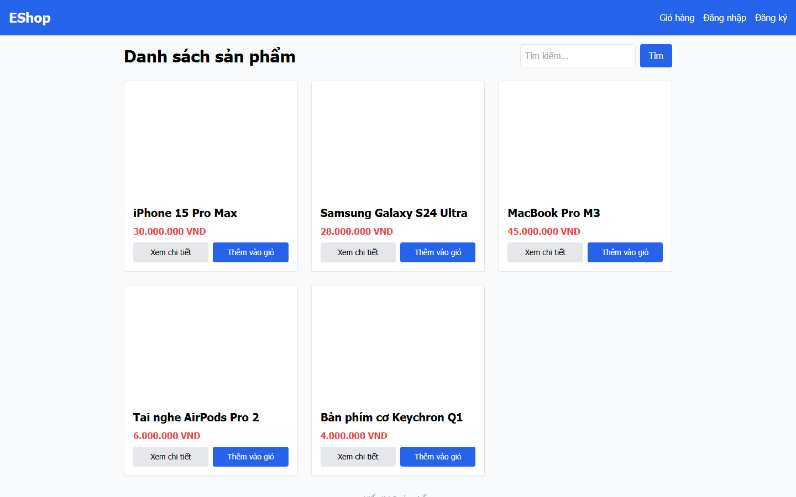

**Chi tiết và observation:** [R01](findings/R01.md). **GitHub Issue:** [#1](https://github.com/tranquocvy/eshop-sut-HW03/issues/1).

### R02 — Product detail omits category

**Phân loại:** R — sai khác yêu cầu. **Severity:** Medium.

**Điều kiện và cách tái hiện:** Mở /product/1 ở VD, đợi chi tiết iPhone 15 Pro Max hiển thị; kiểm tra tên, giá, mô tả và dòng danh mục Điện thoại. Quan sát thiếu danh mục, không suy các trường còn lại lỗi.

**Actual (triệu chứng):** Product name, description, image and price pass; category Điện thoại is absent as category information.

**Instance:** GUI-005--default--D--windows-chromium--VD

**Expected nguyên văn (R):**

> Có ảnh lớn, tên iPhone 15 Pro Max, giá 30000000, mô tả Điện thoại cao cấp của Apple và danh mục Điện thoại.

**Căn cứ:** hw03/gui/GUI_Checklist.md:39; R: FR-06; API §3

**Screenshots:**

**Chi tiết và observation:** [R02](findings/R02.md). **GitHub Issue:** [#2](https://github.com/tranquocvy/eshop-sut-HW03/issues/2).

### R03 — Home product images have empty alternative text

**Phân loại:** R — sai khác yêu cầu. **Severity:** Medium.

**Điều kiện và cách tái hiện:** Open Home and inspect alternative text for all five product images. Separately block an image request and inspect its alt/fallback.

**Actual (triệu chứng):** All five Home images have empty alt. The broken-image variant also records naturalWidth=0 and empty alt. Grouping is the demonstrated same missing alt symptom, not a claim that all broken-image usability criteria fail.

**Instance:** GUI-006--all-seed--H--windows-chromium--VD

**Expected nguyên văn (R):**

> Mỗi ảnh có alt không rỗng, mô tả đúng sản phẩm; không dùng alt chung chung cho tất cả ảnh.

**Căn cứ:** hw03/gui/GUI_Checklist.md:40; R: FR-05/24

**Instance:** GUI-047--default--H--windows-chromium--VD

**Expected nguyên văn (R):**

> Tên, giá và đích chi tiết vẫn dùng được; ảnh hỏng có alt/fallback nhận diện, không khiến cả màn hình trắng.

**Căn cứ:** hw03/gui/GUI_Checklist.md:100; R: FR-24 (alt); H: S13 tr.7/11

**Expected nguyên văn (H):**

> Tên, giá và đích chi tiết vẫn dùng được; ảnh hỏng có alt/fallback nhận diện, không khiến cả màn hình trắng.

**Căn cứ:** hw03/gui/GUI_Checklist.md:100; R: FR-24 (alt); H: S13 tr.7/11

**Screenshots:**

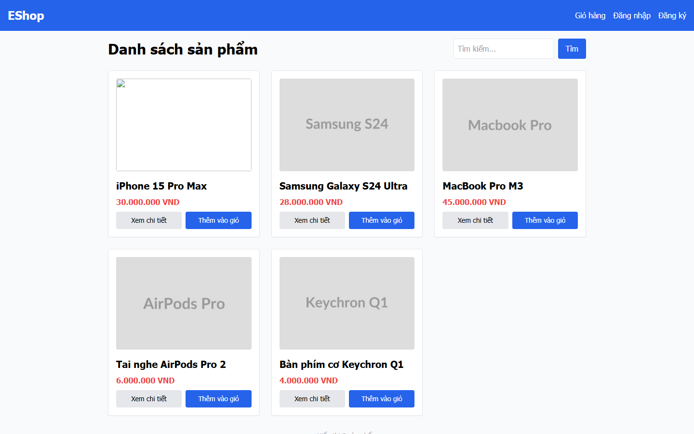

**Chi tiết và observation:** [R03](findings/R03.md). **GitHub Issue:** [#3](https://github.com/tranquocvy/eshop-sut-HW03/issues/3).

### R04 — Home has two level-one headings

**Phân loại:** R — sai khác yêu cầu. **Severity:** Low.

**Điều kiện và cách tái hiện:** Mở Home / ở VD, đợi danh sách tải xong; kiểm tra heading outline/DOM và đếm phần tử h1. Đối chiếu heading danh sách và dòng tổng số sản phẩm.

**Actual (triệu chứng):** Danh sách sản phẩm and Hiển thị 5 sản phẩm are both h1.

**Instance:** GUI-008--default--H--windows-chromium--VD

**Expected nguyên văn (R):**

> Đúng một h1/trang và mô tả nội dung chính; số lượng sản phẩm không tạo h1 thứ hai.

**Căn cứ:** hw03/gui/GUI_Checklist.md:42; R: FR-05/21

**Screenshots:**

**Chi tiết và observation:** [R04](findings/R04.md). **GitHub Issue:** [#4](https://github.com/tranquocvy/eshop-sut-HW03/issues/4).

### R05 — Detail positive action uses green instead of blue

**Phân loại:** R — sai khác yêu cầu. **Severity:** Low.

**Điều kiện và cách tái hiện:** Mở /product/1 ở VD, đợi nội dung tải xong; kiểm tra màu nền computed của nút Thêm vào giỏ hàng và đối chiếu quy định positive action màu xanh dương.

**Actual (triệu chứng):** Detail add button background is rgb(22, 163, 74), not the specified blue.

**Instance:** GUI-010--default--D--windows-chromium--VD

**Expected nguyên văn (R):**

> Các nút hành động tích cực dùng xanh dương nhất quán theo spec; không coi màu của bản triển khai là chuẩn.

**Căn cứ:** hw03/gui/GUI_Checklist.md:44; R: FR-21

**Screenshots:**

**Chi tiết và observation:** [R05](findings/R05.md). **GitHub Issue:** [#5](https://github.com/tranquocvy/eshop-sut-HW03/issues/5).

### H01 — Narrow Home heading collapses into a word column

**Phân loại:** H — vấn đề heuristic/design. **Severity:** Medium.

**Điều kiện và cách tái hiện:** Open Home at the saved VM width 390px; inspect heading beside search form.

**Actual (triệu chứng):** At 390px width the heading is squeezed beside the search form; no horizontal overflow is required to demonstrate this typography/layout failure.

**Instance:** GUI-012--default--H--windows-chromium--VM

**Expected nguyên văn (H):**

> Không cần cuộn ngang toàn trang để đọc/thao tác; nút và form không ra ngoài viewport. Heading và form không ép nhau khiến tiêu đề bị bẻ thành cột từng từ; bố trí lại theo chiều dọc khi cần (tiêu chí H về layout/typography).

**Căn cứ:** hw03/gui/GUI_Checklist.md:46; H: S13 tr.7/22

**Screenshots:**

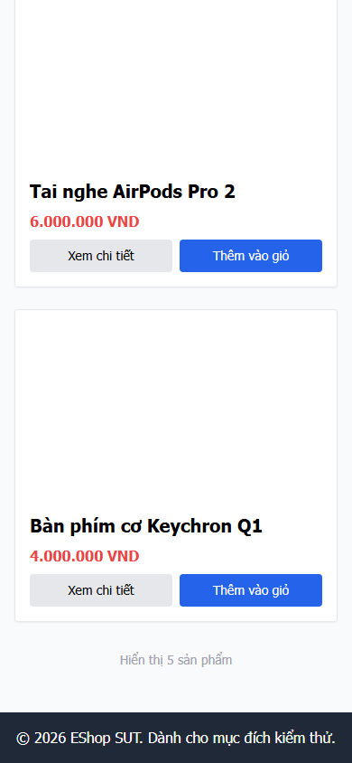

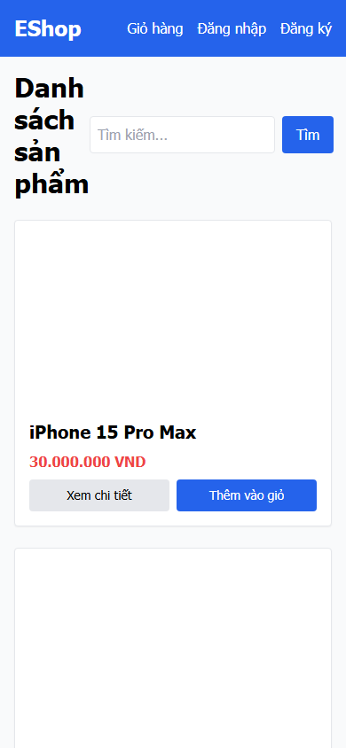

**Chi tiết và observation:** [H01](findings/H01.md). **GitHub Issue:** [#6](https://github.com/tranquocvy/eshop-sut-HW03/issues/6).

### H02 — Search field has only a placeholder

**Phân loại:** H — vấn đề heuristic/design. **Severity:** Medium.

**Điều kiện và cách tái hiện:** Mở Home / ở VD; kiểm tra ô tìm kiếm trước nhập và sau nhập nội dung. Kiểm tra label liên kết và accessible name trong DOM/accessibility; placeholder đơn lẻ không thay label bền vững.

**Actual (triệu chứng):** Captured search textbox has placeholder Tìm kiếm... but no persistent label. This attempt did not type into the field; no typing is claimed.

**Instance:** GUI-016--default--H--windows-chromium--VD

**Expected nguyên văn (H):**

> Có tên mô tả rõ mục đích; khi đã gõ, người dùng vẫn nhận biết được trường là tìm sản phẩm. Placeholder đơn độc không thay nhãn thường trực.

**Căn cứ:** hw03/gui/GUI_Checklist.md:55; H: S13 tr.8/16

**Screenshots:**

**Chi tiết và observation:** [H02](findings/H02.md). **GitHub Issue:** [#7](https://github.com/tranquocvy/eshop-sut-HW03/issues/7).

### R06 — Search keyword is rendered as HTML

**Phân loại:** R — sai khác yêu cầu. **Severity:** High.

**Điều kiện và cách tái hiện:** Open Home. Enter &lt;b&gt;GUI_T01&lt;/b&gt; into search and submit. Inspect the reflected keyword: a b element exists instead of literal text.

**Actual (triệu chứng):** Submitting &lt;b&gt;GUI_T01&lt;/b&gt; creates a b element within the reflected keyword span. This demonstrates HTML injection, not execution of script or proven account compromise.

**Instance:** GUI-022--default--H--windows-chromium--VD

**Expected nguyên văn (R):**

> Nếu từ khóa được phản chiếu, hiển thị nguyên văn như text; không tạo phần tử b hoặc render HTML từ đầu vào.

**Căn cứ:** hw03/gui/GUI_Checklist.md:61; R: FR-05; SEC-04

**Screenshots:**

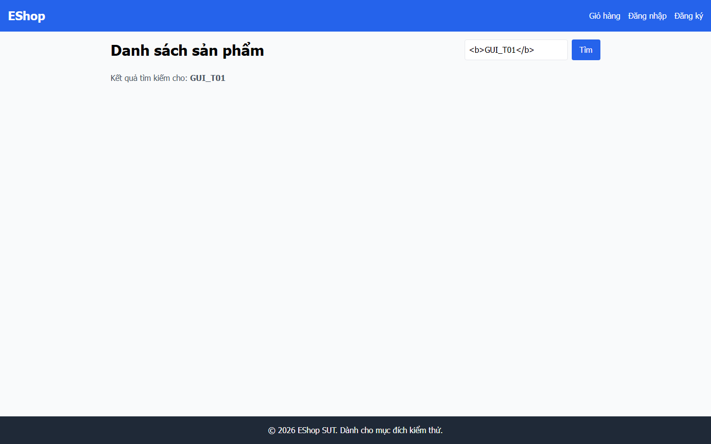

**Chi tiết và observation:** [R06](findings/R06.md). **GitHub Issue:** [#8](https://github.com/tranquocvy/eshop-sut-HW03/issues/8).

### H03 — Quantity spinbutton lacks an accessible name

**Phân loại:** H — vấn đề heuristic/design. **Severity:** Medium.

**Điều kiện và cách tái hiện:** Mở /product/1 ở VD, đợi nội dung; kiểm tra accessible name và label liên kết của quantity spinbutton. Dòng chữ Số lượng nhìn thấy không tự chứng minh liên kết label.

**Actual (triệu chứng):** Visible Số lượng text is a sibling label with no for; the input has no id/aria name and accessibility records an unnamed spinbutton.

**Instance:** GUI-023--default--D--windows-chromium--VD

**Expected nguyên văn (H):**

> Nhãn Số lượng nhận diện đúng ô nhập bằng thị giác lẫn accessible name; không bị nhầm với giá.

**Căn cứ:** hw03/gui/GUI_Checklist.md:62; H: S13 tr.8/16

**Screenshots:**

**Chi tiết và observation:** [H03](findings/H03.md). **GitHub Issue:** [#9](https://github.com/tranquocvy/eshop-sut-HW03/issues/9).

### R07 — Detail breadcrumb is missing

**Phân loại:** R — sai khác yêu cầu. **Severity:** Medium.

**Điều kiện và cách tái hiện:** Mở /product/1 ở VD và đợi nội dung; tìm breadcrumb về Home trong trang chi tiết, đối chiếu yêu cầu navigation.

**Actual (triệu chứng):** Captured detail page has no breadcrumb.

**Instance:** GUI-030--default--D--windows-chromium--VD

**Expected nguyên văn (R):**

> Có breadcrumb phản ánh đúng trang chi tiết; tổ tiên đưa về Home, nhãn cuối nhận diện sản phẩm hiện tại.

**Căn cứ:** hw03/gui/GUI_Checklist.md:76; R: FR-23; L: S13 tr.17

**Screenshots:**

**Chi tiết và observation:** [R07](findings/R07.md). **GitHub Issue:** [#10](https://github.com/tranquocvy/eshop-sut-HW03/issues/10).

### R08 — Add action produces no visible feedback on Home and Detail

**Phân loại:** R — sai khác yêu cầu. **Severity:** Medium.

**Điều kiện và cách tái hiện:** Open Home, activate the first add button once with click; repeat independent saved cases using Enter and Space. Repeat on /product/1. Observe button, header and toast without opening cart.

**Actual (triệu chứng):** Click, Enter and Space leave button/header unchanged and toast list empty. Click also fails, so these are not six independent keyboard defects. R oracle GUI-048 supplies the requirement failure; GUI-031 adds H control-feedback observations. No server write success or production backend defect is inferred.

**Instance:** GUI-031--add-click--D--windows-chromium--VD

**Expected nguyên văn (H):**

> Link đến đúng đích; button kích hoạt cùng hành động như click mà không cần chuột. Với Thêm vào giỏ chỉ quan sát feedback tại H/D, không mở trang giỏ. Nếu click cũng không hoạt động, tách lỗi control khỏi lỗi keyboard.

**Căn cứ:** hw03/gui/GUI_Checklist.md:77; H: S13 tr.8/18

**Instance:** GUI-031--add-click--H--windows-chromium--VD

**Expected nguyên văn (H):**

> Link đến đúng đích; button kích hoạt cùng hành động như click mà không cần chuột. Với Thêm vào giỏ chỉ quan sát feedback tại H/D, không mở trang giỏ. Nếu click cũng không hoạt động, tách lỗi control khỏi lỗi keyboard.

**Căn cứ:** hw03/gui/GUI_Checklist.md:77; H: S13 tr.8/18

**Instance:** GUI-031--add-Enter--D--windows-chromium--VD

**Expected nguyên văn (H):**

> Link đến đúng đích; button kích hoạt cùng hành động như click mà không cần chuột. Với Thêm vào giỏ chỉ quan sát feedback tại H/D, không mở trang giỏ. Nếu click cũng không hoạt động, tách lỗi control khỏi lỗi keyboard.

**Căn cứ:** hw03/gui/GUI_Checklist.md:77; H: S13 tr.8/18

**Instance:** GUI-031--add-Enter--H--windows-chromium--VD

**Expected nguyên văn (H):**

> Link đến đúng đích; button kích hoạt cùng hành động như click mà không cần chuột. Với Thêm vào giỏ chỉ quan sát feedback tại H/D, không mở trang giỏ. Nếu click cũng không hoạt động, tách lỗi control khỏi lỗi keyboard.

**Căn cứ:** hw03/gui/GUI_Checklist.md:77; H: S13 tr.8/18

**Instance:** GUI-031--add-Space--D--windows-chromium--VD

**Expected nguyên văn (H):**

> Link đến đúng đích; button kích hoạt cùng hành động như click mà không cần chuột. Với Thêm vào giỏ chỉ quan sát feedback tại H/D, không mở trang giỏ. Nếu click cũng không hoạt động, tách lỗi control khỏi lỗi keyboard.

**Căn cứ:** hw03/gui/GUI_Checklist.md:77; H: S13 tr.8/18

**Instance:** GUI-031--add-Space--H--windows-chromium--VD

**Expected nguyên văn (H):**

> Link đến đúng đích; button kích hoạt cùng hành động như click mà không cần chuột. Với Thêm vào giỏ chỉ quan sát feedback tại H/D, không mở trang giỏ. Nếu click cũng không hoạt động, tách lỗi control khỏi lỗi keyboard.

**Căn cứ:** hw03/gui/GUI_Checklist.md:77; H: S13 tr.8/18

**Instance:** GUI-048--default--D--windows-chromium--VD

**Expected nguyên văn (R):**

> Có phản hồi trực quan sau lần bấm đầu (toast, trạng thái nút hoặc badge cập nhật). Không cần mở Giỏ hàng/checkout; không suy từ lỗi này rằng validation quantity đã chặn đúng.

**Căn cứ:** hw03/gui/GUI_Checklist.md:101; R: FR-06/24

**Instance:** GUI-048--default--H--windows-chromium--VD

**Expected nguyên văn (R):**

> Có phản hồi trực quan sau lần bấm đầu (toast, trạng thái nút hoặc badge cập nhật). Không cần mở Giỏ hàng/checkout; không suy từ lỗi này rằng validation quantity đã chặn đúng.

**Căn cứ:** hw03/gui/GUI_Checklist.md:101; R: FR-06/24

**Screenshots:**

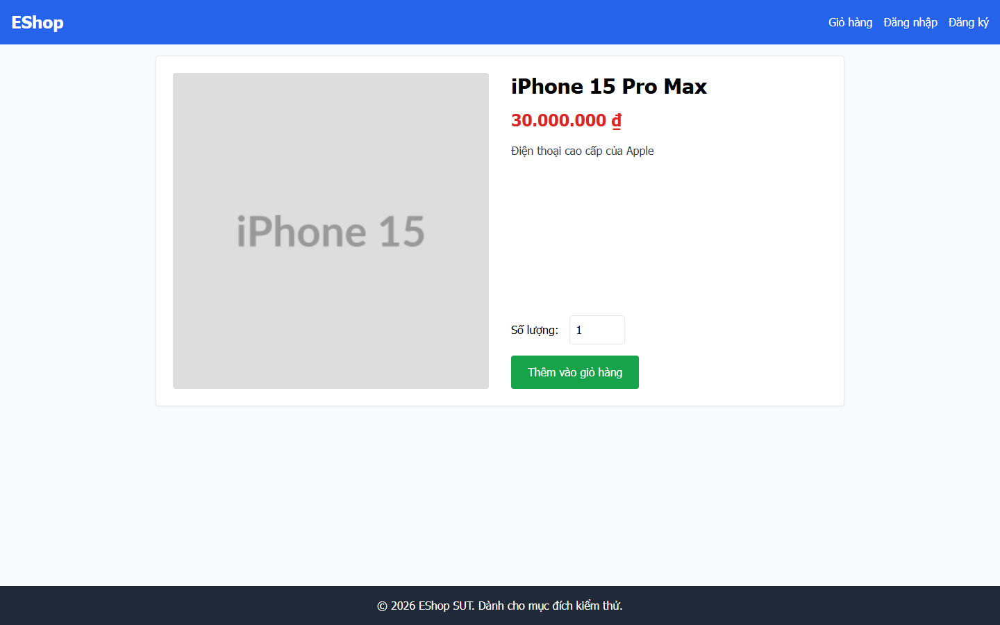

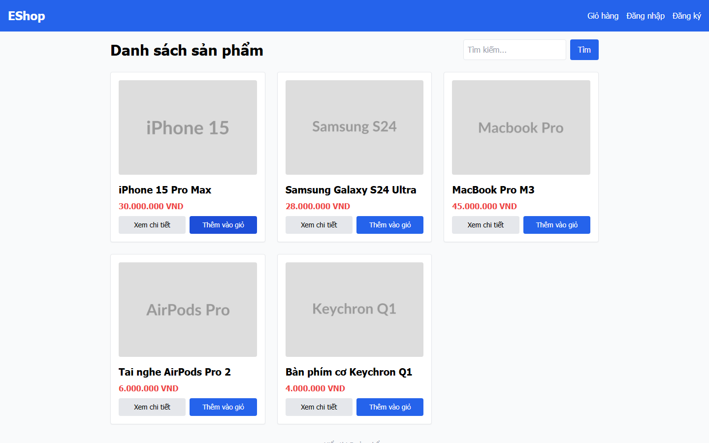

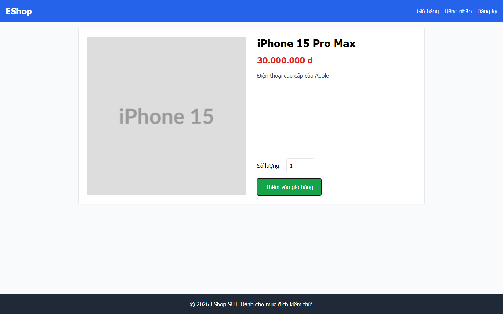

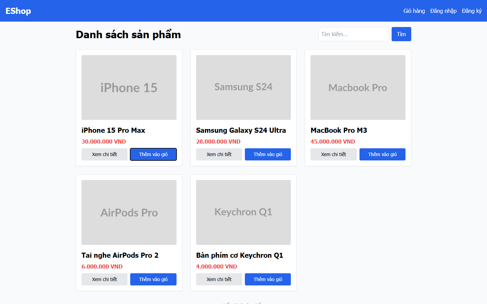

**Chi tiết và observation:** [R08](findings/R08.md). **GitHub Issue:** [#11](https://github.com/tranquocvy/eshop-sut-HW03/issues/11).

### R09 — Home has no route-dependent selected navigation state

**Phân loại:** R — sai khác yêu cầu. **Severity:** Low.

**Điều kiện và cách tái hiện:** Mở Home / ở VD; kiểm tra navbar cho route Home hiện tại, đối chiếu selected-state bằng màu/weight và aria-current. Không mở rộng kết luận này sang Detail đang needs-review.

**Actual (triệu chứng):** Home and Detail navbar classes/content are identical; logo is always bold and other links only hover:underline. Home logo maps to /, but no selected highlight varies with route. Absence of aria-current alone is not the oracle. Detail applicability remains unresolved.

**Instance:** GUI-036--default--H--windows-chromium--VD

**Expected nguyên văn (R):**

> Mục navbar ánh xạ trang hiện hành được highlight, không chọn sai trang (R). Nếu Detail không có mục ánh xạ, ghi trường hợp này là điểm applicability cần làm rõ; không dùng breadcrumb để chấm navbar đạt. Breadcrumb có kiểm tra riêng GUI-030.

**Căn cứ:** hw03/gui/GUI_Checklist.md:82; R: FR-23; applicability của Detail chưa được SRS mô tả rõ

**Screenshots:**

**Chi tiết và observation:** [R09](findings/R09.md). **GitHub Issue:** [#12](https://github.com/tranquocvy/eshop-sut-HW03/issues/12).

### R10 — Home list and search omit loading indication

**Phân loại:** R — sai khác yêu cầu. **Severity:** Medium.

**Điều kiện và cách tái hiện:** Delay the initial list GET by about two seconds and inspect pending/settled UI. Separately delay an iPhone search GET and compare pending/settled UI.

**Actual (triệu chứng):** Initial pending list shows only heading/search; search pending retains old cards. Both requests settle but no loading indicator is shown. Grouped by missing pending feedback, not a proven shared implementation cause.

**Instance:** GUI-037--default--H--windows-chromium--VD

**Expected nguyên văn (R):**

> Có chỉ báo đang tải trong thời gian pending; không biểu diễn tạm thời như không có sản phẩm. 2 giây chỉ để làm trạng thái quan sát được.

**Căn cứ:** hw03/gui/GUI_Checklist.md:90; R: FR-05

**Instance:** GUI-038--default--H--windows-chromium--VD

**Expected nguyên văn (R):**

> Có trạng thái loading khi pending; khi xong thay bằng kết quả, không còn chỉ báo tải treo.

**Căn cứ:** hw03/gui/GUI_Checklist.md:91; R: FR-05; L: S13 tr.13/14

**Screenshots:**

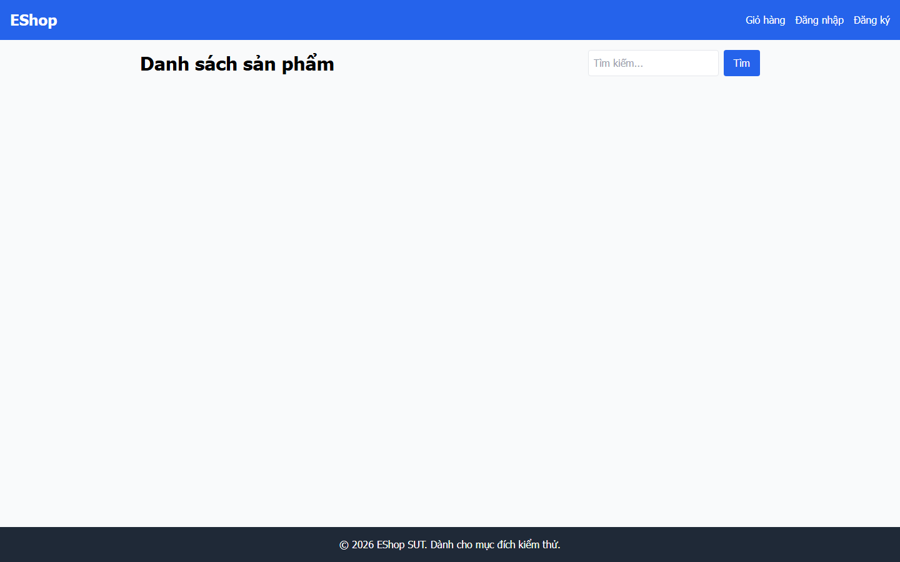

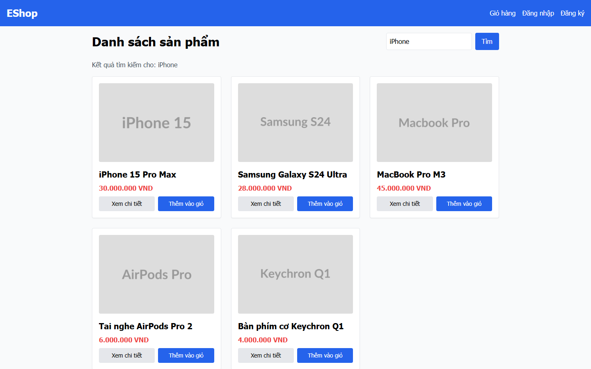

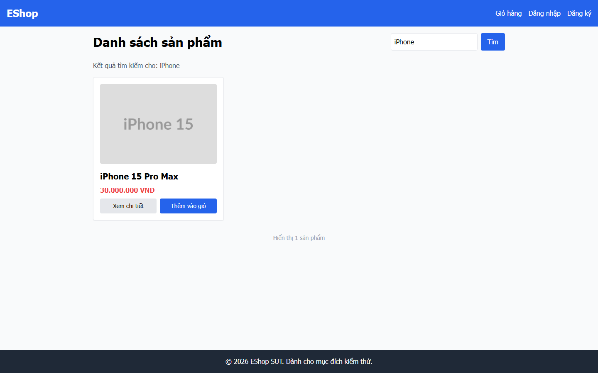

**Chi tiết và observation:** [R10](findings/R10.md). **GitHub Issue:** [#13](https://github.com/tranquocvy/eshop-sut-HW03/issues/13).

### R11 — No-result search lacks message and illustration

**Phân loại:** R — sai khác yêu cầu. **Severity:** Medium.

**Điều kiện và cách tái hiện:** Open Home, search zzzz_T01_no_match_23120410 and await zero results.

**Actual (triệu chứng):** No-match search returns zero cards and an empty grid without friendly empty-state message or icon. GUI-051 is blocked by this missing empty-state root, not another bug.

**Instance:** GUI-040--default--H--windows-chromium--VD

**Expected nguyên văn (R):**

> Có message thân thiện và icon/hình minh họa; không để lưới trắng hoặc giữ thẻ cũ như kết quả hiện tại.

**Căn cứ:** hw03/gui/GUI_Checklist.md:93; R: FR-05/24

**Screenshots:**

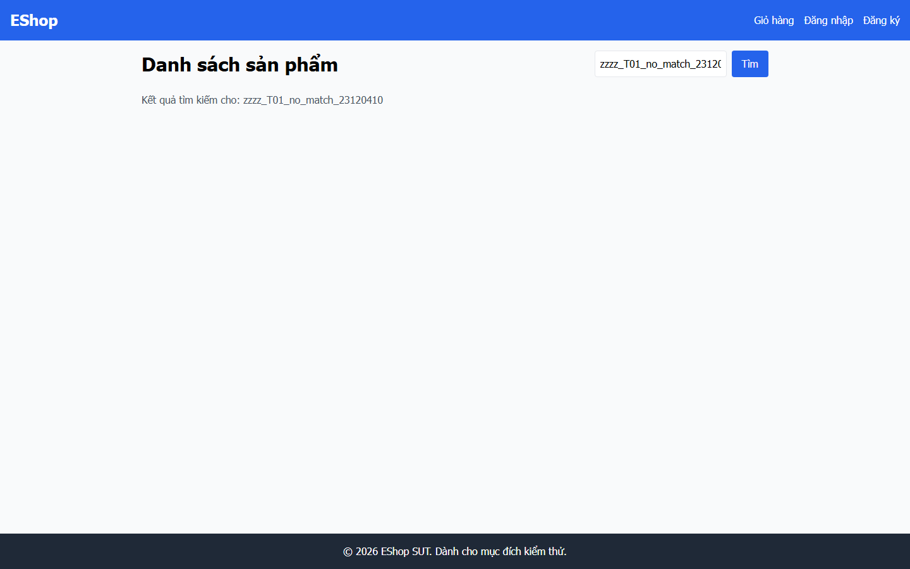

**Chi tiết và observation:** [R11](findings/R11.md). **GitHub Issue:** [#14](https://github.com/tranquocvy/eshop-sut-HW03/issues/14).

### H04 — Home request failures have no error feedback

**Phân loại:** H — vấn đề heuristic/design. **Severity:** Medium.

**Điều kiện và cách tái hiện:** Open Home with initial product GET aborted, then separately abort a submitted iPhone search; separately fulfill initial GET with HTTP 500. Observe the page after failure.

**Actual (triệu chứng):** Network abort for initial/search and actual HTTP 500 on initial list show no understandable error message; search can retain old cards. Grouped by demonstrated Home error-feedback omission, not presumed server cause.

**Instance:** GUI-041--initial--H--windows-chromium--VD

**Expected nguyên văn (H):**

> Cả A và B có thông báo lỗi dễ hiểu, không gọi lỗi mạng là không có kết quả; không hiển thị stack trace/SQL. Một lượt không đại diện cho cả hai biến thể.

**Căn cứ:** hw03/gui/GUI_Checklist.md:94; H: S13 tr.11/16/27

**Instance:** GUI-041--search--H--windows-chromium--VD

**Expected nguyên văn (H):**

> Cả A và B có thông báo lỗi dễ hiểu, không gọi lỗi mạng là không có kết quả; không hiển thị stack trace/SQL. Một lượt không đại diện cho cả hai biến thể.

**Căn cứ:** hw03/gui/GUI_Checklist.md:94; H: S13 tr.11/16/27

**Instance:** GUI-052--default--H--windows-chromium--VD

**Expected nguyên văn (H):**

> Hiển thị thông báo lỗi tải dữ liệu; không hiển thị danh sách rỗng như thể không có sản phẩm hoặc loading vô hạn.

**Căn cứ:** hw03/gui/GUI_Checklist.md:103; H: S13 tr.11/16/27 (thông báo lỗi); FR-05 làm bối cảnh tải danh sách

**Screenshots:**

**Chi tiết và observation:** [H04](findings/H04.md). **GitHub Issue:** [#15](https://github.com/tranquocvy/eshop-sut-HW03/issues/15).

### H05 — Detail request failure remains loading

**Phân loại:** H — vấn đề heuristic/design. **Severity:** Medium.

**Điều kiện và cách tái hiện:** Open /product/1 with its product GET aborted; observe the page after failure.

**Actual (triệu chứng):** After simulated network abort, Detail remains Đang tải... instead of a distinct load error. Kept separate from Home because the visible symptom differs.

**Instance:** GUI-043--default--D--windows-chromium--VD

**Expected nguyên văn (H):**

> Thông báo lỗi tải khác trạng thái không tìm thấy; không để Đang tải vô hạn sau request thất bại.

**Căn cứ:** hw03/gui/GUI_Checklist.md:96; H: S13 tr.11/16/27

**Screenshots:**

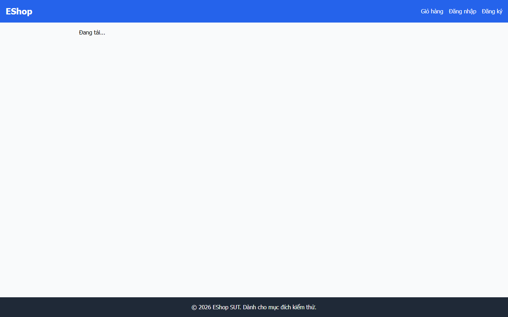

**Chi tiết và observation:** [H05](findings/H05.md). **GitHub Issue:** [#16](https://github.com/tranquocvy/eshop-sut-HW03/issues/16).

### H06 — Older search response overwrites newer results

**Phân loại:** H — vấn đề heuristic/design. **Severity:** Medium.

**Điều kiện và cách tái hiện:** Open Home. Hold the iPhone search response, submit MacBook and let it finish, then release iPhone. Compare the final label and cards.

**Actual (triệu chứng):** Saved sequence holds iPhone, completes MacBook, releases iPhone; final label is MacBook but result is iPhone 15 Pro Max.

**Instance:** GUI-045--default--H--windows-chromium--VD

**Expected nguyên văn (H):**

> Sau khi cả hai xong, kết quả/nhãn cuối ứng với MacBook, response iPhone cũ không ghi đè. Throttling chung không đủ chứng minh điều kiện này; nếu không giữ/thả được từng request thì chưa thực thi.

**Căn cứ:** hw03/gui/GUI_Checklist.md:98; H: S13 tr.12/14/20

**Screenshots:**

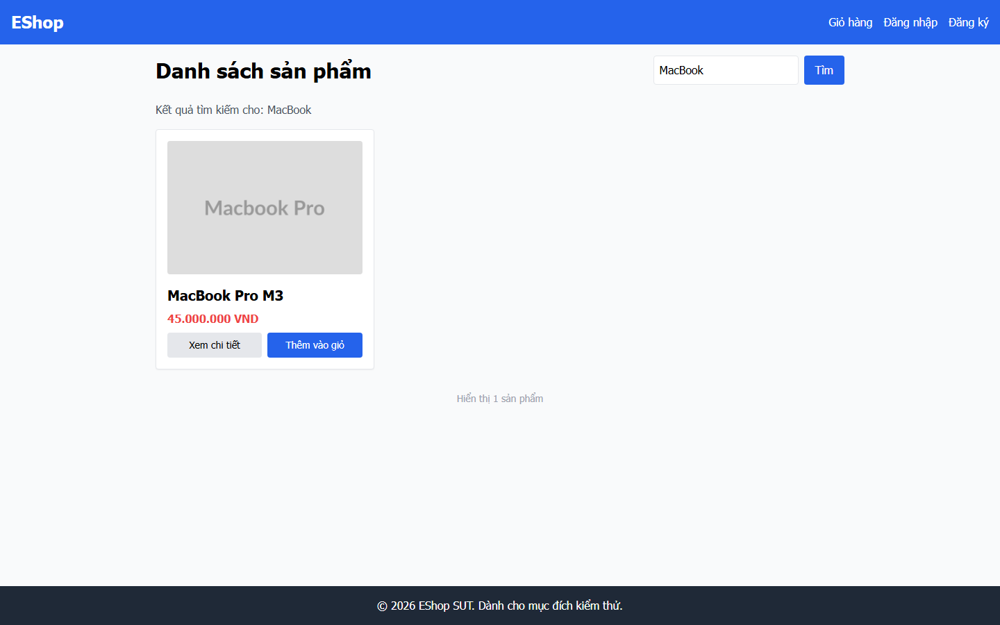

**Chi tiết và observation:** [H06](findings/H06.md). **GitHub Issue:** [#17](https://github.com/tranquocvy/eshop-sut-HW03/issues/17).

### H07 — Search label follows unsubmitted draft text

**Phân loại:** H — vấn đề heuristic/design. **Severity:** Medium.

**Điều kiện và cách tái hiện:** Open Home. Submit iPhone and await its result. Edit the search field to MacBook without submitting. Compare label and cards.

**Actual (triệu chứng):** After submitting iPhone and editing draft to MacBook without resubmit, label says MacBook while iPhone results remain. Kept separate from response race because no out-of-order response is needed.

**Instance:** GUI-046--default--H--windows-chromium--VD

**Expected nguyên văn (H):**

> Nếu có nhãn Kết quả tìm kiếm cho, nó phản ánh iPhone cho đến lần submit tiếp theo; không gán kết quả cũ cho chuỗi đang soạn.

**Căn cứ:** hw03/gui/GUI_Checklist.md:99; H: S13 tr.12/14

**Screenshots:**

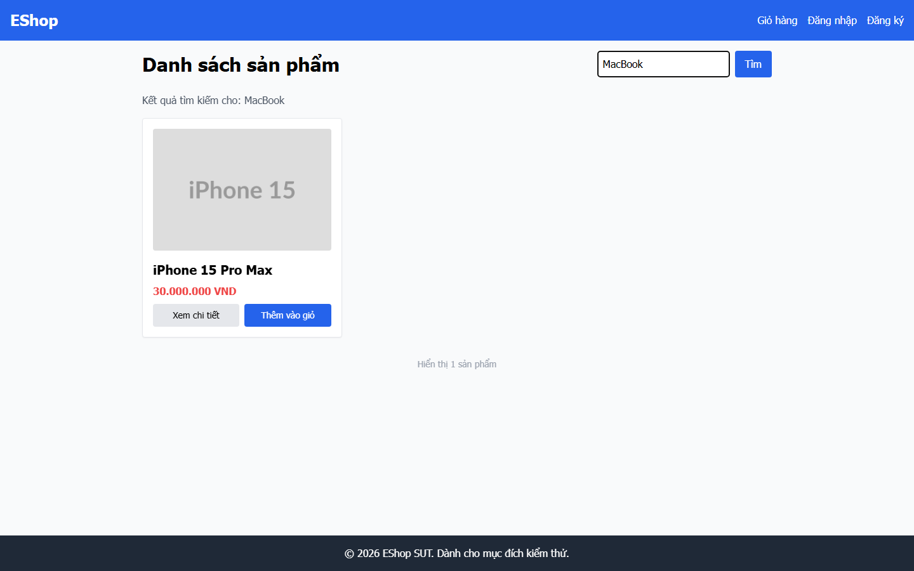

**Chi tiết và observation:** [H07](findings/H07.md). **GitHub Issue:** [#18](https://github.com/tranquocvy/eshop-sut-HW03/issues/18).

### R12 — Required quantity label lacks asterisk

**Phân loại:** R — sai khác yêu cầu. **Severity:** Low.

**Điều kiện và cách tái hiện:** Open /product/1. Inspect quantity label with value 1 and empty input.

**Actual (triệu chứng):** Both quantity 1 and empty variants show Số lượng: without required *. This is a label criterion, not proof of quantity validation behavior.

**Instance:** GUI-049--1--D--windows-chromium--VD

**Expected nguyên văn (R):**

> Có dấu `*` cạnh nhãn trường bắt buộc theo FR-22, không chỉ báo bằng placeholder. Search không bắt buộc vì cho phép tìm rỗng.

**Căn cứ:** hw03/gui/GUI_Checklist.md:68; R: FR-06/22

**Instance:** GUI-049--empty--D--windows-chromium--VD

**Expected nguyên văn (R):**

> Có dấu `*` cạnh nhãn trường bắt buộc theo FR-22, không chỉ báo bằng placeholder. Search không bắt buộc vì cho phép tìm rỗng.

**Căn cứ:** hw03/gui/GUI_Checklist.md:68; R: FR-06/22

**Screenshots:**

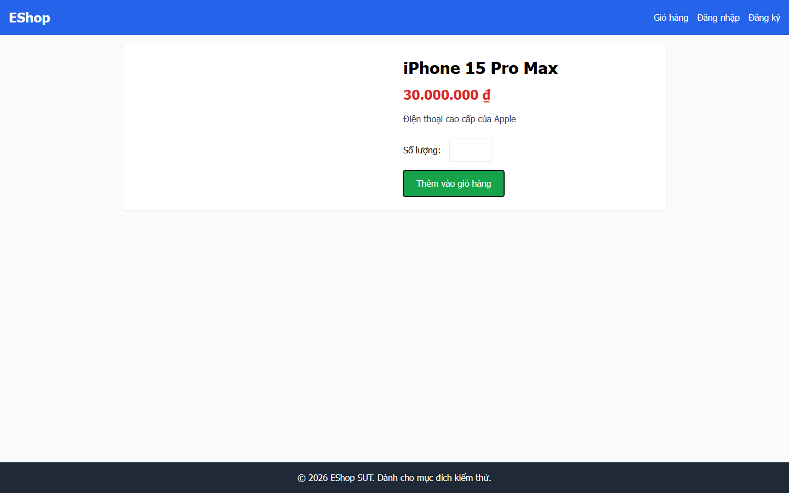

**Chi tiết và observation:** [R12](findings/R12.md). **GitHub Issue:** [#19](https://github.com/tranquocvy/eshop-sut-HW03/issues/19).

## Đối chiếu yêu cầu bàn giao Task 1

| Yêu cầu §6 / §14 | Evidence hiện có | Trạng thái |
|---|---|---|
| Checklist >40 mục, phủ IA-01–04 và review/bổ sung của sinh viên | 52 mục, nguồn và attribution trong GUI_Checklist.md; sheet Design | Có artifact; giữ provenance |
| Execute, kết quả và Notes cho Failed; ảnh Failed | 122 dòng Execution; 31 Fail có Notes và mapping ảnh; 15 Blocked và 1 needs-review công khai | Chưa được hiểu là full assertion coverage |
| Mọi bug trong Markdown report | 19 nhóm trực tiếp trong report này; 31 failed variants map duy nhất | Đủ coverage tập Fail đã ghi nhận trong phạm vi run |
| Mọi bug trên GitHub Issues, mỗi issue có screenshot | 19 Issues, 43 lần nhúng dùng 20 PNG nguồn, URL từng nhóm bên trên | Đã đăng; đã kiểm body và HTML ảnh do GitHub render |
| Main report Markdown + PDF | Bản Task 1 này và PDF tương ứng | Không thay report cuối toàn bài gồm usability |

Không có bug mới được suy từ 15 Blocked hoặc GUI-036 Detail needs-review. GUI-051 message-disappearance liên kết prerequisite thiếu của GUI-040/R11, không nhân đôi thành một bug. Không có lượt chạy SUT mới trong lần hợp nhất báo cáo.

## Evidence GitHub công khai

Đã kiểm 19/19 Issues và 43/43 lượt nhúng ảnh bằng browser không đăng nhập. [39 ảnh chụp và bảng xác minh](publication-evidence/README.md). Đây là verification công bố, không phải lượt chạy SUT mới.
