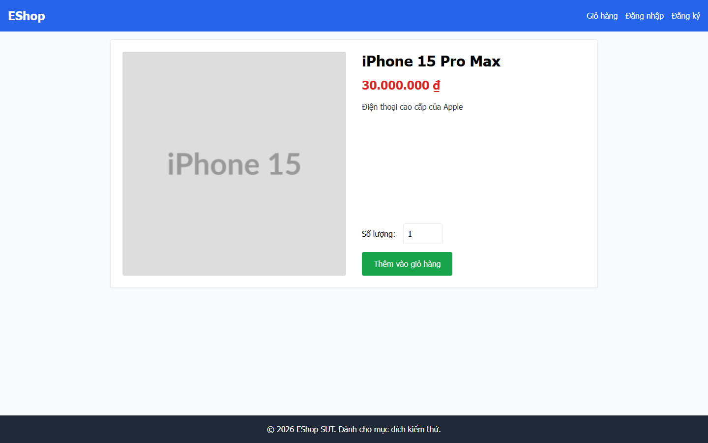
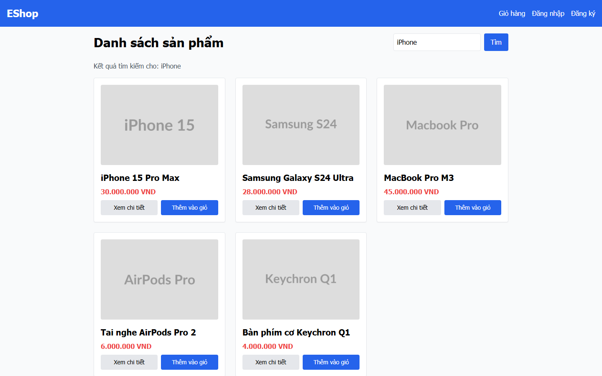

# Task 2 — Đánh giá usability EShop

Ngày tổng hợp: 10/11/2026. **Đã hoàn tất phân tích dữ liệu hiện có của bảy phiên chính; không đồng nghĩa đủ mọi nghĩa vụ nộp bài hoặc được 40/40.** Báo cáo không chứa tên, contact, raw consent, câu trả lời nguyên văn hoặc recordings. Phụ lục dữ liệu và bảng participant nằm trong bộ private dành cho giảng viên/TA, không đăng GitHub.

## 1. Mục tiêu và phạm vi

Nguồn: HW03 §5, §6 Task 2 (ba phases), §11–12, §14–15. Đề dành 40 điểm cho scenario + 7 sessions + analysis, không công bố phân bổ con. Tham chiếu theo section vì bản trích PDF không có ranh giới trang đáng tin cậy.

Flow đã chọn: **Home/listing/search → Product Detail → lựa chọn điện thoại**, không yêu cầu thêm giỏ hoặc checkout. [Thiết kế](EVALUATION-DESIGN.md) ghi profile A và success criteria K1; [protocol](PROTOCOL.md), [instruments](INSTRUMENTS.md) giữ nội dung chuẩn bị.

- RQ1: người dùng có tìm được sản phẩm và tới chi tiết không; vướng ở đâu, mất bao lâu?
- RQ2: thông tin tên/giá/mô tả có đủ để lựa chọn có căn cứ không?
- RQ3: khi gặp khó khăn/no-result, người dùng có tự phục hồi không?

**Scenario chung:** Bạn đang cân nhắc mua một chiếc điện thoại cho bản thân, với ngân sách tối đa 30 triệu đồng. Hãy dùng EShop để tìm một sản phẩm phù hợp. Khi đã quyết định, cho biết bạn chọn sản phẩm nào, giá bao nhiêu và thông tin nào trên website giúp bạn lựa chọn. Chưa cần mua hoặc thêm vào giỏ hàng.

K1 yêu cầu: sản phẩm đáp ứng loại/ngân sách; mở đúng chi tiết và xác định tên/giá; nêu căn cứ trên site. Không bắt buộc search, so sánh hai sản phẩm, mua hàng hoặc thương hiệu cụ thể.

## 2. Phương pháp, pilot và provenance

Bảy participant P01–P07, mỗi người một phiên chính cuối cùng, screening eligibility chung được chọn Có. Profile dự kiến: từ 18 tuổi, đọc tiếng Việt, từng tìm/xem sản phẩm online trong 12 tháng, ngoài lớp HW03. Portal không thu riêng tuổi/nghề/IT background từng người; không suy ra mẫu non-IT hoặc phân bố nhân khẩu học từ eligibility chung. Bảng tên/contact đã che bốn số giữa do điều phối cung cấp được lưu private để TA xác minh; không tuyên bố TA đã gọi xác minh.

Participant dùng portal HTTPS và SUT ở tab riêng; moderator local-only. Mỗi phiên gồm consent → chuẩn bị → scenario → task → SUS → probes → video. Người điều phối xác nhận trực tiếp điều phối, không trợ giúp và không ghi nhận phàn nàn bằng lời ở cả bảy phiên. Đây là ghi nhận tổng quát, **không phải nhật ký friction/error/hesitation có timestamp**. Các câu trả lời viết sau phiên vẫn chứa bất mãn; không mâu thuẫn với việc không nghe phàn nàn bằng lời.

Tất cả chỉ cho phép quay màn hình, không cho ghi âm; không có audio để tái dựng think-aloud hoặc trích lời nói. Việc yêu cầu think-aloud từng phiên không có evidence độc lập; không tuyên bố đã có transcript. Notes của P01 về audio được giữ trong clarification riêng, không sửa consent gốc. Các cờ recorderChecked/playbackChecked trong raw prepare đều false; giữ nguyên, không ghi ngược true sau khi nhận video. Việc video được điều phối xem lại là review sau phiên, không phải preflight đã được chứng minh.

Có PILOT-01 nội bộ với người thiết kế/thuộc lớp, hoàn thành survey/video trước mẫu chính; không tính vào n=7. State ghi pilot review và freeze version 2 tại **2026-11-10T03:46:22.008Z**. Pilot review không yêu cầu đổi thêm trước main collection. Đây là **diễn tập kỹ thuật nội bộ**, không thay bằng chứng pilot đại diện target profile. Đề không nói rõ pilot phải ngoài lớp; báo cáo giữ giới hạn thay vì tự khẳng định pilot đạt trọn yêu cầu. Không tạo pilot bổ sung hồi tố.

Main sessions cùng compact-screen-v1, probes v0.4, SUS 10 câu; scenario D2-A, K1, INSTRUMENTS-v0.4. Snapshot instruments giữ nguyên. Provenance SUT: 5444b25aad5cd9942d3962f8beab3879dc1e10bb; source/DB hashes lưu private. External API transport adapter, source UI gốc được kiểm hash; không sửa SUT hoặc reset data để lấy kết quả thuận lợi.

### Sự cố và deviations

- P05 có một attempt bị ngắt kỹ thuật ở task, chưa survey/video cuối. Attempt cũ được lưu riêng, excludedFromMainAggregate=true. Lượt làm lại là P05 hiện hành, không phải participant thứ tám. Có **learning effect** do đã tiếp xúc task. Tổng main attempts ghi nhận: 8 cho 7 người; 7 completed attempts được phân tích.
- P06 cấp lại invitation vì link dùng một lần đã được dùng; giữ cùng session ID, phase, answers, evidence và task release. Không reset task, không ghi nhận thành repeat participant.
- Transport origins thay đổi giữa các lượt; không thay câu hỏi/scenario hoặc dữ liệu phiên cũ. Tunnel đã dừng sau thu thập.
- Nhiều ý kiến nhắc nút mua/thêm giỏ dù scenario không yêu cầu. Đây là tín hiệu **scope contamination**, chưa đủ chứng minh ai thực sự checkout hoặc nguyên nhân hành vi. Phân biệt feedback ngoại vi với completion của flow chính.

## 3. Kết quả từng phiên và performance

| Mã | SUS | Video review |
|---|---:|---|
| P01 | 45 | Điều phối đã xem; hash khớp |
| P02 | 40 | Điều phối đã xem; hash khớp |
| P03 | 55 | Điều phối đã xem; hash khớp |
| P04 | 27,5 | Điều phối đã xem; hash khớp |
| P05 | 50 | Video lượt làm lại; hash khớp |
| P06 | 45 | Điều phối đã xem; hash khớp |
| P07 | 42,5 | Điều phối đã xem; hash khớp |

Sản phẩm, giá và lý do tự báo giữ trong bộ private, không công bố câu trả lời gốc. Nội dung tự báo chưa chứng minh cả ba tiêu chí K1. Không có task outcome/K1 được moderator nhập: **7 unknown**, không phải 7 fail hay 7 pass. 7/7 tự báo hoàn tất là self-report, không phải tỷ lệ hoàn thành độc lập đã quan sát.

- Trợ giúp: điều phối báo không trợ giúp trong 7/7 phiên; không suy từ đó mọi task thành công.
- K1/completion độc lập: **không tính**, n có outcome kiểm chứng = 0.
- Task time: **không tính**, n timing có nguồn kiểm chứng = 0. Độ dài video và khoảng timestamp portal không được dùng thay task time.
- Recovery thực tế/search-no-result: **chưa xác minh**. recoveryChoice/answers.recoveryObserved là tự báo, không phải review.recoveryObserved. Không chia số người phục hồi thành công cho số người trả lời Có.
- Errors/hesitations: không có mã hóa chi tiết từ video; không ghi 0 lỗi hoặc 0 do dự. Video được con người review nội dung nói chung, chưa có timeline phân tích thao tác.

## 4. Chấm điểm SUS

Nguồn phương pháp: [MeasuringU — SUS](https://measuringu.com/sus/), thang gốc John Brooke. Câu lẻ contribution=response−1; câu chẵn=5−response; tổng ×2,5. Mỗi phiên có đủ 10 số nguyên 1–5. Contributions và raw 70 responses nằm trong SUS.csv/analysis.json private; pilot bị loại.

**n=7; mean 43,57; median 45; min–max 27,5–55; sample SD 8,64 (mẫu số n−1).** Tổng score=305. Kiểm công thức với vectors biên 0/50/100 và so chéo summary portal; kết quả khớp. Sensitivity mô tả, bỏ P05 lặp thì n=6, mean=42,50; không dùng con số này thay kết quả chính hoặc loại người vì score.

SUS không phải phần trăm task success hay điểm bài tập. Bản Việt là bản dịch làm việc AI hỗ trợ, chưa thẩm định tâm trắc; không gán grade/percentile/normative pass-fail. Các score cho thấy đánh giá trải nghiệm còn hạn chế trong mẫu này, không chẩn đoán root cause hay suy rộng toàn EShop. Feedback mua/giỏ ngoài scope có thể ảnh hưởng overall SUS.

## 5. Probes v0.4

| Nhóm/câu hỏi | Có | Không | Không chắc | Bỏ qua |
|---|---:|---:|---:|---:|
| Clarity: có thông tin/nút chưa hiểu rõ? | 6 | 1 | 0 | 0 |
| Recovery: có bấm nhầm/gặp lỗi/bị kẹt? | 5 | 1 | 1 | 0 |
| Speed: có bước lâu hơn mong đợi? | 4 | 3 | 0 | 0 |
| Trust: thông tin đủ để quyết định chọn điện thoại? | 0 | 6 | 1 | 0 |

Mỗi hàng n=7. Ý nghĩa Có khác nhau: Có ở trust là đủ thông tin; Có ba hàng đầu là báo khó khăn. Không đảo chiều hoặc tính tổng thành một thang chuẩn. P05 chọn Có clarity/recovery nhưng không giải thích: **không suy nguyên nhân**. P07 không tin tưởng nhưng mô tả đánh giá chung, không suy cụ thể thiếu thông tin nào. Ô explanation trống không phải phủ nhận khó khăn; unsure không gộp no.

## 6. Nhóm pain points, classification và severity

Phân tích thematic của câu trả lời viết và notes tổng quát; không phải phân tích khung hình video. Thang làm việc: S3 cản mục tiêu đã chứng minh; S2 friction đáng kể nhưng chưa chứng minh blocker; S1 nhẹ; S0 thông tin/chưa đủ evidence. Severity là analyst assessment có giới hạn, không phải rubric bắt buộc. Tần suất dưới đây là **số người nhắc trong 7 người được hỏi**, không phải số đã tiếp xúc control, tỷ lệ lỗi hoặc tỷ lệ thị trường. Nhóm có thể overlap.

### U01 — Tương tác nút/feedback không rõ hoặc không đáp ứng

**Ưu tiên P1, S2 tạm thời.** P02/P03/P04/P06/P07 nhắc nút/thêm giỏ/mua trong clarity hoặc recovery: **5/7 mentions**. P01 nhắc đặt hàng không có thông báo là một tín hiệu bổ sung riêng, không tự gộp thành cùng lỗi. P05 không có detail để gán U01. Ảnh hưởng tự báo: không biết control có nhận, phải lặp hoặc thấy khó chịu. Chưa có evidence cho K1 bị chặn; không chấm S3.

Classification: recurring interaction/feedback problem; **bug candidate ở mức triệu chứng**. [R08/#11](https://github.com/tranquocvy/eshop-sut-HW03/issues/11) có bằng chứng GUI độc lập về thiếu visible feedback sau activation, không chứng minh cùng root cause hoặc backend không ghi thành công. Đặc biệt lời nhắc cần bấm hai lần chưa được tái hiện trong phân tích này; không khẳng định double-click là cách sửa.

Khuyến nghị: phản hồi rõ sau lần kích hoạt đầu, trạng thái pending/success/error và chống lặp ngoài ý muốn; xác minh UI cùng API trước sửa. Mua/giỏ không phải success criterion của task nên báo như peripheral observation, không mở rộng flow hồi tố.

### U02 — Thông tin hỗ trợ quyết định còn thiếu

**Ưu tiên P1, S2 tạm thời; design/content issue.** 6/7 chọn thông tin chưa đủ (P01/P03/P04/P05/P06/P07); 1/7 không chắc (P02). Trong đó **3/7 có giải thích cụ thể về thiếu ảnh/mô tả/thông tin: P01/P04/P06**. Không gán cùng nguyên nhân cho ba người chỉ chọn Không hoặc đánh giá chung.

Ảnh hưởng: confidence quyết định thấp, nhưng chưa chứng minh chọn sai hay không hoàn thành. Khuyến nghị ưu tiên ảnh thực, mô tả và thuộc tính so sánh liên quan điện thoại/ngân sách; thử lại decision task sau cải tiến. Yêu cầu payment của P01 nằm ngoài scope, tách khỏi nhu cầu thông tin lựa chọn. Không coi thiếu mọi thuộc tính do người dùng muốn là requirement bug nếu spec không yêu cầu.

### U03 — Tốn thời gian/chờ đợi

**Ưu tiên P2, S1 tạm thời; performance/feedback candidate.** P03/P04/P06/P07: **4/7 speed=yes**. Nội dung trải từ thao tác mua/thêm sản phẩm tới tải chậm/đánh giá toàn bộ. Không có timing đo được, không gán cho API/SUT hoặc tunnel một cách chắc chắn.

Khuyến nghị đo pending/settled bằng instrumentation riêng sau nghiên cứu, có loading/error feedback và review lại control; đối chiếu [R10/#13](https://github.com/tranquocvy/eshop-sut-HW03/issues/13) chỉ như background GUI về loading indicator, **không phải bằng chứng nguyên nhân của bốn phản hồi**. Không đặt benchmark latency tùy ý.

### U04 — Đặt hàng không có thông báo (ngoài flow)

**Ưu tiên xác minh, S0; isolated bug candidate.** P01: 1/7 nhắc đặt hàng thiếu thông báo. Chưa rõ endpoint, state, thực sự đã đặt hay dùng từ đặt hàng cho add-to-cart; không đồng nhất với U01. Không có repro/screenshot riêng xác minh checkout. Giữ như tín hiệu cần điều tra, không mở Issue khẳng định lỗi checkout hoặc dùng làm kết quả flow đã chọn.

### Synthesis

Tín hiệu lặp lại rõ nhất là chất lượng thông tin quyết định và interaction feedback. Không có blocker đã chứng minh; absence of evidence không phải evidence of absence. Các theme recurring gợi ý vấn đề thiết kế hệ thống nhưng root cause vẫn chưa biết. Một phản hồi đơn lẻ chưa đủ thành bug confirmed. Không dùng 19 nhóm GUI Task 1 thay số lượng usability findings.

## 7. Bug report và evidence công khai có sẵn

Không có genuine bug **mới** được xác minh độc lập trong phân tích này; do đó không tạo Issue trùng hoặc công bố video/quote participant. Hai Issue nền đã có screenshot độc lập:

- #11 / R08: thiếu phản hồi UI sau add, expected/actual/repro ở [R08](../gui/task1/findings/R08.md). Nguồn expected GUI-048 (FR-06/24), GUI-031 bổ sung heuristic. Giới hạn runtime read-only và chưa chứng minh write/persistence giữ nguyên.
- #13 / R10: thiếu loading indication list/search, [R10](../gui/task1/findings/R10.md). Chỉ liên hệ với recommendation, không claim participant tái hiện lỗi đó.

Ảnh kỹ thuật độc lập, không lấy từ video participant:

Số mới: 4 themes phân tích, 0 newly confirmed bugs, 0 new Issues; không gọi 4 themes là 4 bugs. Genuine bug mới chỉ báo Markdown + GitHub Issue/screenshot sau xác minh, không suy từ SUS.

## 8. Trả lời RQ và giới hạn

- RQ1: 7 người tự báo xong; chưa có K1/timing mã hóa nên chưa kết luận effectiveness/efficiency độc lập. Control friction recurring nhưng nhiều ý kiến ngoại vi task.
- RQ2: 6/7 chưa thấy đủ thông tin, 1/7 unsure; ba người mô tả thiếu thông tin cụ thể. Đây là ưu tiên thiết kế có dữ liệu hỗ trợ, không phải chứng minh tên/giá sai.
- RQ3: 5/7 tự báo khó khăn; chưa có exposed denominator, đường đi/recovery evidence nên chưa kết luận recovery success.

Mẫu nhỏ/convenience, catalog 5 sản phẩm, task ngắn và hai điện thoại phù hợp; không so sánh nhóm hoặc suy rộng. Learning effect P05, thiên lệch survey, bản dịch SUS chưa validated, chỉ pilot nội bộ, không audio, notes không có timestamp và feedback ngoài scope đều giới hạn diễn giải. Không thể chữa thiếu hụt thiết kế trước phiên bằng tài liệu hậu kỳ.

## 9. Ma trận hoàn tất và nghĩa vụ còn lại

| Hạng mục | Bằng chứng / trạng thái |
|---|---|
| Scenario/profile/RQ | Có thiết kế và scenario goal-based; scope giữ nguyên |
| Pilot trước main | Có diễn tập nội bộ + review/freeze; representativeness chưa chứng minh |
| 7 phiên / eligibility / roster | Có 7 submitted/reviewed main; eligibility chung; bảng private, TA verification chưa thực hiện |
| Screen recording | 7 video, 40.365.653 bytes, size/SHA-256 khớp; điều phối đã xem |
| Notes/moderation | 7 notes tổng quát; friction/error/hesitation timeline chưa có |
| SUS/probes | 70 SUS values hợp lệ, 28 probe choices; score kiểm chéo, findings/severity hoàn tất theo dữ liệu hiện có |
| Genuine bugs | Tái sử dụng Issue/screenshot GUI đã có; không xác minh bug mới |
| Report | Markdown + PDF và private CSV/JSON/evidence index |
| Session commits / analysis commit | Không tạo lại lịch sử hoặc backdate; commit thực tế từng phiên chưa được chứng minh trong bộ này |
| Hồ sơ toàn bài | Main report hợp nhất, AI Audit/Critique/PDF, Git log cuối bài và ZIP nằm ngoài closeout Task 2 này |

**Trạng thái:** collection và analysis đóng theo dữ liệu hiện có, các evidence gaps nêu rõ. Không đánh dấu đủ mọi yêu cầu/đạt điểm tối đa. Không sửa raw, consent, video hoặc bù outcome/timing.

## 10. Bộ private và kiểm tra

Thư mục private task02-final-20261110 gồm report, Participants-private.md, participant-roster.json, SUS.csv, analysis.json, study-snapshot-redacted.json (raw answers/notes), interrupted-attempt-audit.json, video-manifest.json và videos/. Snapshot chứa pilot nhưng aggregate chỉ dùng P01–P07. Không kèm mật khẩu, study.sqlite, cookie hoặc invitation secrets vào bộ bàn giao.

SHA-256/size xác minh lại trực tiếp từ 7 file nguồn trước copy; manifest lưu mapping mã→evidence ID→file→hash. Con người review nội dung; chương trình kiểm integrity, không phải AI xem video. Rút dữ liệu trước 23/11/2026, xóa theo policy 09/12/2026; quyền truy cập giới hạn giảng viên/TA và tổ chức như consent, không suy consent công khai. Tắt tunnel không xóa evidence hoặc hủy quyền rút dữ liệu.

## 11. Nguồn

- Đề 2026.HW03.GUI Usability_En.pdf, §5–6, §11–12, §14–15.
- Slide S13: components, task selection, summarizing performance/preference, analyzing data; nguồn SUS riêng ở trên.
- EVALUATION-DESIGN.md, PROTOCOL.md, INSTRUMENTS.md; PILOT.md và ONLINE-STUDY-PLAN.md là hồ sơ thiết kế/lịch sử, không tự thay bằng kết quả.
- Study snapshot/export sau P07; bảy session reports riêng; interrupted attempt P05; roster riêng; video manifest.
